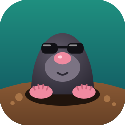

<p align="center"></p>

<h1 align="center">Крот</h1>

<p align="center"><b>Роет туннели под любыми стенами.</b><br>Свой VPN на своих серверах — без консоли.</p>

Крот — приложение с окном (Windows, macOS, Linux) и командная строка.

- **Две схемы.**
  - Каскад: вход в России → выход за границей. Устройства видят только российский адрес, поэтому схема переживает белые списки мобильных операторов и блокировку зарубежных адресов.
  - Один зарубежный сервер: проще и дешевле.
- **Модули на выбор, с пояснениями.**
  - AmneziaWG (приложение AmneziaVPN, профиль по QR).
  - VLESS XHTTP с постквантовым шифрованием, Hysteria2.
  - Подписка для Happ, v2rayNG, Hiddify.
  - Прокси для Telegram (MTProxyL) с маскировкой под ваш сайт.
  - «Российское — напрямую», по желанию — через Cloudflare WARP, чтобы российские сайты не видели адрес хостинга.
  - Защита от сканеров и госсетей, резервные копии, мониторинг с оповещениями в Telegram.
- **Безопасно.**
  - Перед каждым шагом установки делается снимок. Если проверка не прошла или связь пропала, шаг откатывается сам.
  - Серверы переводятся на вход по ключу, пароль root нигде не хранится.
  - Секреты лежат только у вас на компьютере, в зашифрованном хранилище.
- **Подключения в пару нажатий.** Для каждого устройства — QR-код и ссылка.

## Скачать

Готовые сборки — на странице [Releases](../../releases/latest):

| Система | Приложение | Командная строка |
|---|---|---|
| Windows 10/11 | `krot-app-…-windows-amd64.exe` (ARM — `-arm64`) | `krot-cli-…-windows-amd64.exe` |
| macOS (Intel и Apple Silicon) | `krot-app-…-macos-universal.zip` | `krot-cli-…-macos-arm64` / `-amd64` |
| Linux | `krot-app-…-linux-amd64.tar.gz` (ARM — `-arm64`) | `krot-cli-…-linux-amd64` |

Сборки не подписаны: Windows и macOS предупредят при первом запуске. Как запустить — в описании релиза.

## Как пользоваться

[docs/USAGE.md](docs/USAGE.md):
- как выбрать схему;
- какие серверы и домен нужны;
- мастер установки по шагам;
- раздача подключений, обслуживание;
- что делать, если что-то пошло не так;
- то же самое через командную строку.

Коротко:
1. Арендуйте VPS с KVM и Ubuntu 24.04/26.04 или Debian 12/13: один за границей или два (Россия + заграница). Лучше купить и домен.
2. Откройте приложение → **«Новая установка…»** → схема → серверы (IP и пароль root) → домен → состав → установка.
3. На экране сервера добавьте клиентов: у каждого будет QR и ссылка.
4. Сохраните копию ключа пульта (`~/.krot/age.key`): без него не расшифровать ни настройки, ни резервные копии.

## Документация

| Хочу | Документ |
|---|---|
| поставить свой VPN и пользоваться им | [docs/USAGE.md](docs/USAGE.md) |
| узнать, подойдёт ли сервер | [docs/40-requirements.md](docs/40-requirements.md) |
| разобраться в конкретном модуле | [docs/20-server-modules/](docs/20-server-modules/) |
| понять, как устроена программа, и добавить модуль | [docs/ARCHITECTURE.md](docs/ARCHITECTURE.md) |
| безопасность | [docs/50-security.md](docs/50-security.md) |
| известные грабли и как они обойдены | [docs/60-pitfalls.md](docs/60-pitfalls.md) |
| как обновляются компоненты | [docs/70-updates.md](docs/70-updates.md) |

## Сборка из исходников

Нужны Go (версия — в `go.mod`), Node.js 22 и Wails CLI v2.16. Подробно — [app/README.md](app/README.md).

```
go build -o krot ./cmd/krot                              # командная строка
go install github.com/wailsapp/wails/v2/cmd/wails@v2.16.0
cd app && wails build                                        # окно; на Linux: wails build -tags webkit2_41
```

Тесты: `go test ./...`. Релиз: тег `vX.Y.Z` → GitHub Actions соберёт приложение и CLI под все платформы и опубликует релиз с `SHA256SUMS` ([.github/workflows/release.yml](.github/workflows/release.yml)).

## Правила репозитория

- **Секретов здесь нет и не должно быть.** Перед каждым коммитом: `bash tools/redact-check.sh` должен вывести «чисто».
- Новый модуль: манифест `modules/<имя>.yaml` с блоком `catalog:` плюс скрипты `agent/<имя>/`. Каталог сверяет `go test ./internal/wizard/`.

## Лицензия

[GPL-3.0-or-later](LICENSE) © авторы Крота. Пользоваться, менять и распространять можно свободно; изменённую версию, которую вы распространяете, нужно выпускать тоже с открытым кодом под GPL.
